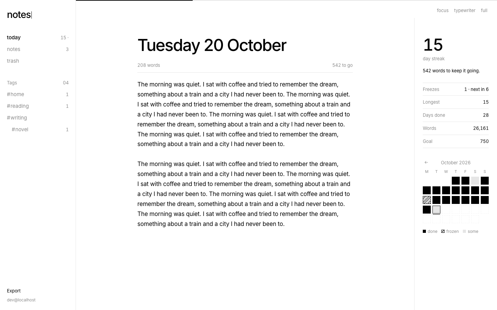
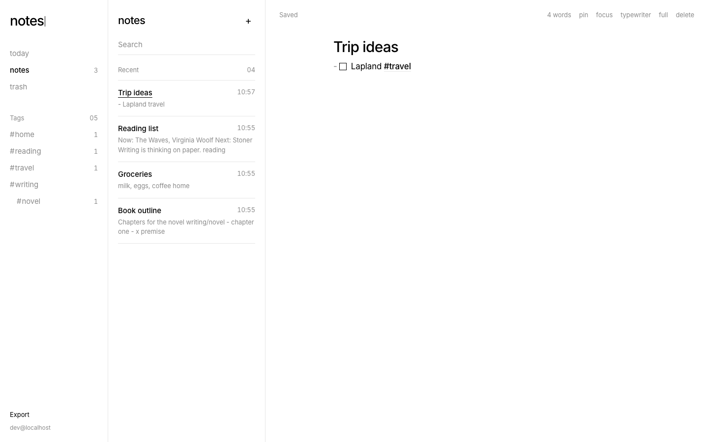

# notes

A private writing space: Bear-style markdown notes with tags, plus a daily 750-words diary with a streak that forgives the odd missed day.

**Live:** [notes.knhdixh.com](https://notes.knhdixh.com). It's private and only lets in its owner through Cloudflare Access.




## Features

| | |
|---|---|
| **Diary** | One page per day, a goal hairline across the top, live word count, "done" once you reach the goal |
| **Smart streak** | Every 7 completed days earns a *freeze* (max 2), and a freeze covers one missed day automatically. The day ends at 3 a.m. local time, so late-night writing still counts. Only words written *on* the day count, so editing an old entry can't fake a streak |
| **History** | Month calendar (done / frozen / partial). Past entries open read-write |
| **Notes** | Markup editor (headings, bold, quotes, code, links) with markers visible but muted, like Ulysses. The first line is the title, like Bear |
| **Tags** | `#tag` and `#nested/tag` anywhere in a note, with a tag tree in the sidebar. ⌘-click a tag to filter |
| **Checklists** | `- [ ]` renders a clickable box. Enter continues lists, checklists and quotes |
| **Writing modes** | Focus (dims all but the current paragraph), typewriter (caret stays centred), full screen (⌘.) |
| **Safe saving** | Autosaves 0.7 s after you stop typing, keeps a local copy until the server confirms, retries when offline |
| **Library** | Search, pin, trash with restore, JSON export |

Shortcuts: ⌘K search · ⌘J today · ⌘⌥N new note · ⌘. full screen · Esc exits full screen.

## How it works

- One Cloudflare Worker serves the static frontend (`public/`, no framework, no build step at deploy) and a JSON API (`src/worker.js`) backed by D1.
- **Access control:** Cloudflare Access sits in front of the custom domain with an allow policy for a single email (one-time PIN login, 30-day session). The Worker verifies the `Cf-Access-Jwt-Assertion` JWT itself (signature against the team's JWKS, audience, issuer, expiry, owner email; see `src/access.js`). If Access were ever misconfigured, the API would still refuse. `*.workers.dev` redirects to the custom domain.
- The streak engine, word counter and tag parser live in `public/lib.js`, shared by the browser and the Worker and covered by tests.
- The editor is CodeMirror 6, bundled once into `public/vendor/editor.js` (`npm run vendor`).

Stack: Cloudflare Workers · D1 · Cloudflare Access · CodeMirror 6 · plain JS · `node:test`.

## Run locally

```bash
npm install
cp .dev.vars.example .dev.vars   # DEV_LOGIN=1 skips the Access check locally
npm run dev                      # http://localhost:8787
npm test
```

## Deploy your own

1. `npx wrangler d1 create notes` and put the id in `wrangler.jsonc`.
2. Create a Cloudflare Access self-hosted application for your hostname with an allow policy for your email. Put its **AUD** tag and your team domain in `wrangler.jsonc` (`ACCESS_AUD`, `ACCESS_TEAM_DOMAIN`), and set your hostname in `routes` and `CANONICAL_HOST`.
3. `npx wrangler secret put OWNER_EMAIL` (the only secret).
4. `npm run deploy` (applies D1 migrations, then deploys).

## Limitations

- Single owner by design: no accounts, no sharing.
- Last write wins when the same note is edited on two devices at once.
- No image attachments yet.
